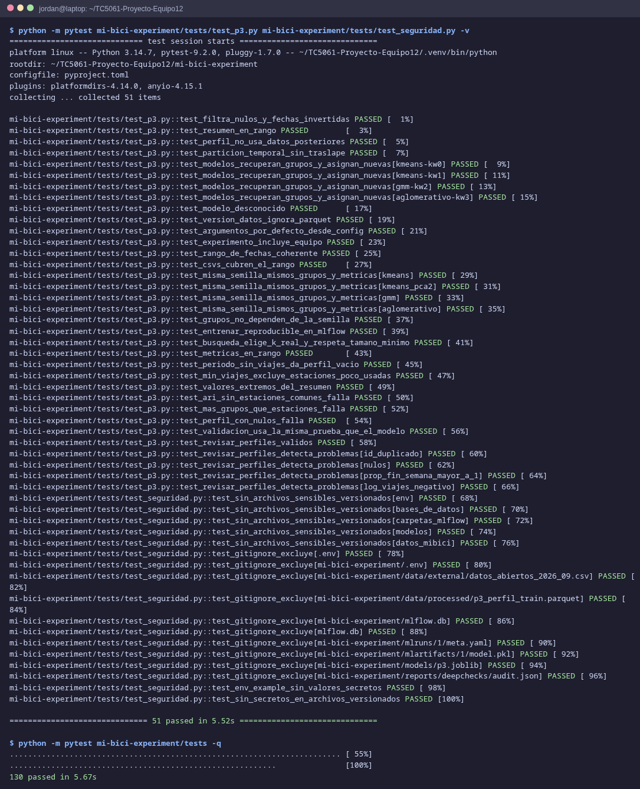
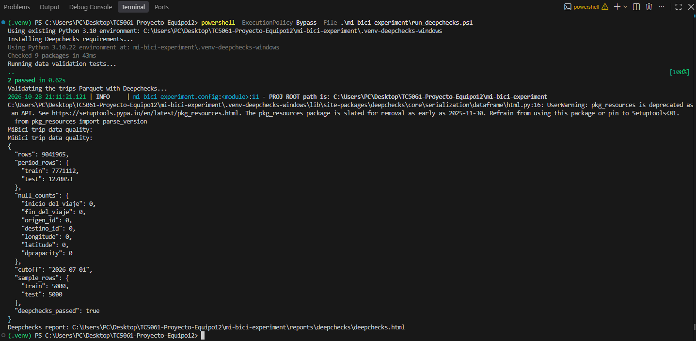
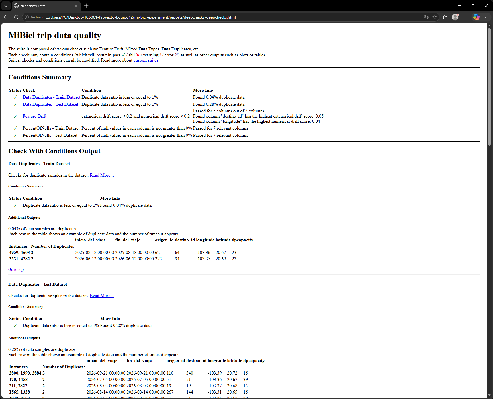
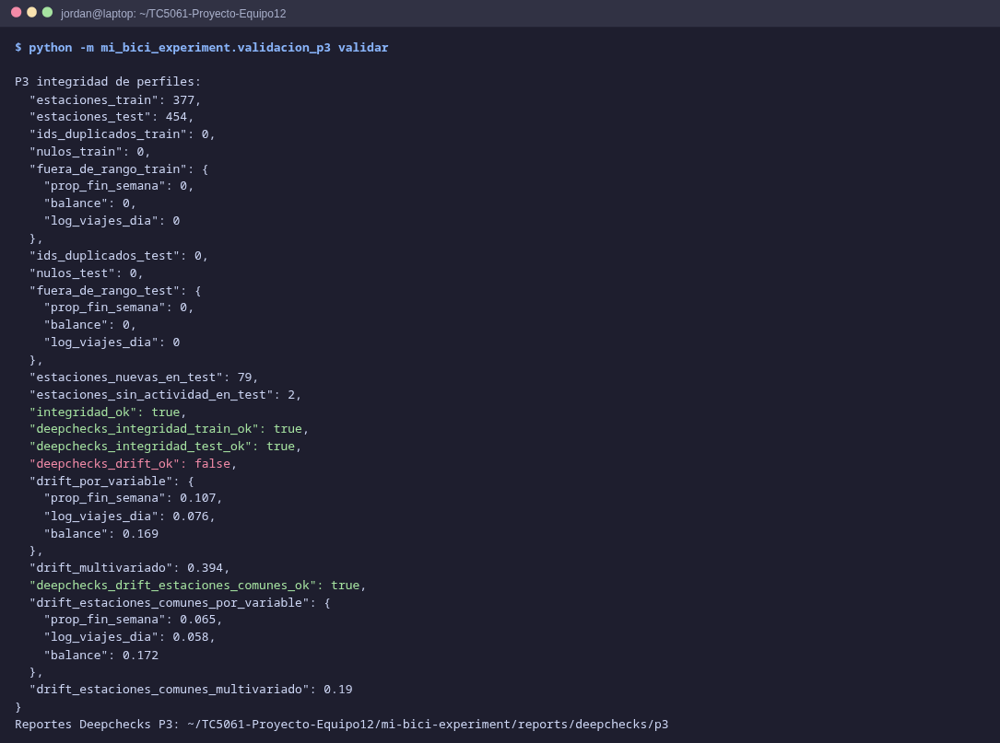
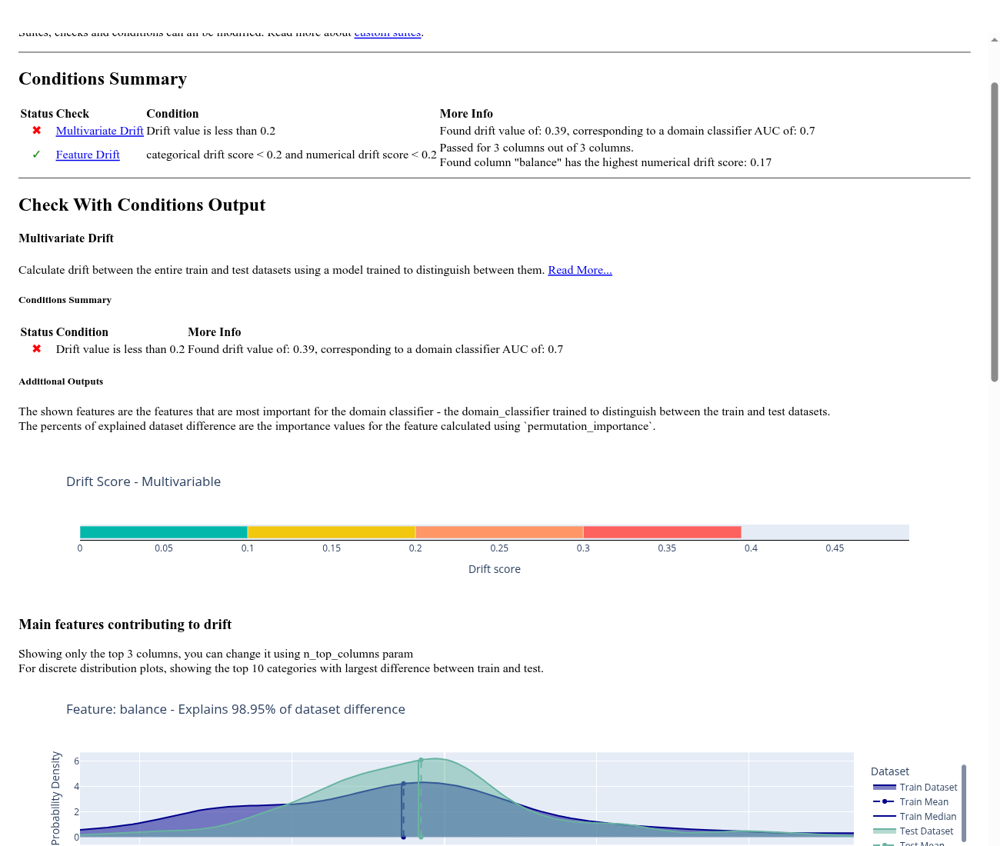
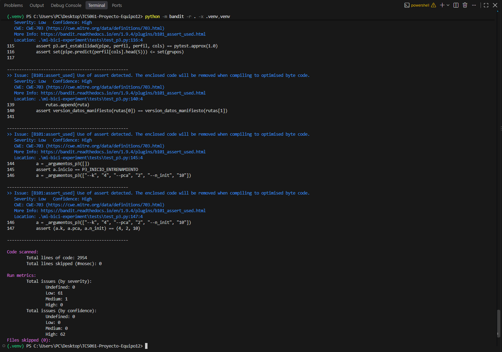
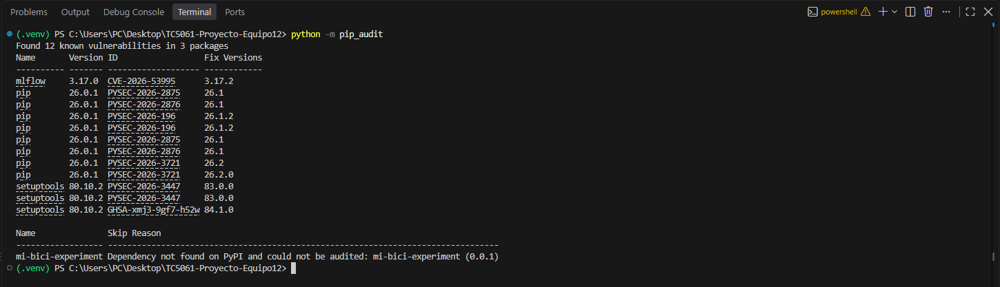
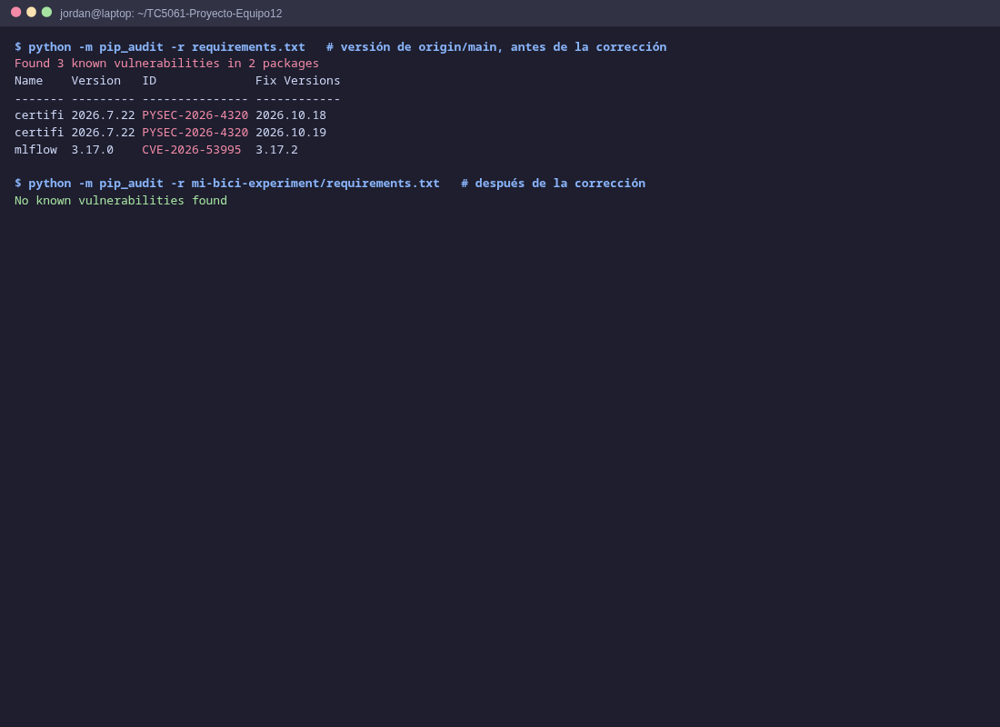
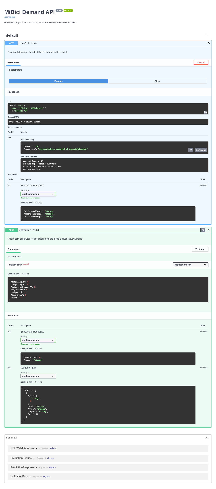

# TC5061 Proyecto MiBici, Equipo 12

[](https://161.132.54.170/apirest/)
[](https://161.132.54.170/api/docs)
[](https://161.132.54.170/)
[](https://www.docker.com/)
[](https://fastapi.tiangolo.com/)
[](https://www.python.org/)
[](https://github.com/oscarM190/TC5061-Proyecto-Equipo12/actions/workflows/mlflow.yml)
<a target="_blank" href="https://cookiecutter-data-science.drivendata.org/">
    
</a>

Proyecto integrador del curso TC5061 Operaciones de Aprendizaje Automático (MLOps), Tec de Monterrey.
El equipo propone y valida soluciones de Machine Learning para la operación de MiBici, el sistema de
bicicleta pública del Área Metropolitana de Guadalajara, con datos reproducibles y experimentos
registrados en MLflow.

## Preguntas del proyecto

| # | Pregunta | Tarea | Formulación | Usuario |
|---|----------|-------|-------------|---------|
| P1 | ¿Cuántos viajes se iniciarán en una estación o zona en un periodo futuro? | Regresión | Viajes iniciados por estación y día, con rezagos de 1 y 7 días y promedio móvil de 7 días | Operador del sistema |
| P2 | ¿Una estación estará en riesgo de quedarse sin bicicletas o sin anclajes? | Clasificación | Estado de cada estación al día siguiente (sin bicicletas, balanceada o sin anclajes) a partir del balance neto diario (llegadas − salidas) dividido entre su capacidad | Equipo de rebalanceo |
| P3 | ¿Qué grupos de estaciones comparten patrones de uso y dónde se ubican? | Clustering | Grupos de estaciones según el peso del fin de semana, la intensidad de uso diaria y el balance llegadas/salidas (la ingesta trunca las fechas al día) | Planeación urbana |

## Datos

- **Fuente:** [portal de datos abiertos de MiBici](https://www.mibici.net/es/datos-abiertos/). Viajes por
  mes (`datos_abiertos_AAAA_MM.csv`) y nomenclatura de estaciones (`nomenclatura_2026_09.csv`). Las URL
  exactas están en `MI_BICI_CSVS` de `mi_bici_experiment/config.py`.
- **Rango:** octubre de 2024 a septiembre de 2026 (24 meses; septiembre de 2026 es el último mes
  publicado). Cubre dos años completos de estacionalidad.
- **Tamaño:** 9,041,965  viajes crudos en 24 archivos, y un archivo de nomenclatura que contiene 484 estaciones.
- **Variables usadas:** `Inicio_del_viaje`, `Fin_del_viaje`, `Origen_Id`, `Destino_Id` de los viajes, y
  `id`, `name`, `latitude`, `longitude`, `dpcapacity` de la nomenclatura.
- **Condiciones de uso:** el portal publica los datos para explorarlos y reutilizarlos, sin una licencia
  explícita. El equipo los usa con fines académicos, cita la fuente y no los redistribuye: `data/` está
  excluida de Git.
- **Datos personales:** los viajes incluyen `Usuario_Id`, `Genero` y `Año_de_nacimiento`. Ningún modelo
  los usa: `features.parquet` solo conserva las columnas de la lista anterior, y no se registran en MLflow.
- **Partición temporal** 70% para entrenamiento, 15% para validación y 15% para pruebas.

## Estructura

El proyecto se generó con [Cookiecutter Data Science](https://cookiecutter-data-science.drivendata.org/)
dentro de `mi-bici-experiment/`:

```
├── .github/workflows/mlflow.yml   <- Pipeline de GitHub Actions
├── MLproject                      <- Configuración del MLflow Project
├── python_env.yaml                <- Entorno de MLflow (Python y dependencias)
├── README.md                      <- Este documento
└── mi-bici-experiment
    ├── Makefile                   <- Comandos de conveniencia (make requirements, make test)
    ├── pyproject.toml             <- Metadatos del paquete; Python 3.14.7
    ├── requirements.txt           <- Dependencias con versión fija
    ├── setup.cfg                  <- Configuración de flake8
    ├── data                       <- Datos de MiBici
    │   ├── raw                    <- CSVs originales de viajes y nomenclatura
    │   ├── interim                <- Datos unificados de viajes y nomenclatura
    │   └── processed              <- Datos procesados para entrenar modelos
    ├── docs                       <- Documentación mkdocs de la plantilla
    ├── models                     <- Modelos serializados
    ├── notebooks                  <- Notebooks de Jupyter
    │   └── images                 <- Imágenes usadas en los notebooks
    ├── references                 <- ML Canvas y diagrama de arquitectura
    ├── reports/figures            <- Figuras generadas por los modelos
    ├── tests                      <- Pruebas con pytest
    └── mi_bici_experiment         <- Código del proyecto
        ├── config.py              <- Rutas, fechas, semilla, columnas y parámetros
        ├── dataset.py             <- Descarga de CSV y conversión a Parquet
        ├── features.py            <- Variables de los modelos
        ├── plots.py               <- Gráficas que se registran como artefactos
        ├── tracking.py            <- Registro de experimentos y artefactos en MLflow
        └── modeling
            ├── predict.py         <- Predicciones con modelos registrados
            ├── run.py             <- Ejecución de los flujos de modelado
            ├── train.py           <- Entrenamiento de modelos
            └── modules             <- Implementaciones de modelos para P1, P2 y P3
                ├── p1_regression
                │   └── models.py
                ├── p2_classification
                │   └── models.py
                └── p3_clustering
                    ├── estimadores.py
                    └── models.py
```

## Instalación

Requiere Python 3.14.7 y Git. Desde un clon limpio:

```bash
git clone https://github.com/oscarM190/TC5061-Proyecto-Equipo12.git
cd TC5061-Proyecto-Equipo12/mi-bici-experiment
python3.14 -m venv .venv
source .venv/bin/activate          # Windows: .venv\Scripts\activate
pip install -r requirements.txt
pip install -e .                   # el paquete, para importarlo desde notebooks/ (o: make requirements)
```

Todos los comandos siguientes se ejecutan desde la raíz del repositorio.

## MLflow Project

El repositorio es un MLflow Project: [`MLproject`](MLproject) declara el entorno
([`python_env.yaml`](python_env.yaml), con las mismas versiones fijas de `requirements.txt`) y los puntos
de entrada. Todas las corridas de la actividad 5 se lanzan con `mlflow run` desde la raíz del repositorio.

### Servidor de tracking

El Model Registry necesita un almacenamiento con base de datos. En una terminal aparte, desde la raíz:

```bash
mlflow server --backend-store-uri sqlite:///mlflow.db --port 5000
export MLFLOW_TRACKING_URI=http://127.0.0.1:5000      # Windows: set MLFLOW_TRACKING_URI=...
```

### Puntos de entrada

| Entry point | Parámetros | Qué hace |
|-------------|------------|----------|
| `ingest` | | Descarga los CSV, genera el Parquet y `data_manifest.json` |
| `train` | `question` (p1, p2, p3), `model` y sus hiperparámetros | Entrena y registra una corrida |
| `search` | `question`, `model`, `ks`, `pcas` | Búsqueda con nested runs: una corrida padre y una hija por combinación |
| `register` | `question`, `run_id`, `alias` | Registra el modelo de una corrida en el Model Registry y le asigna un alias |

Los hiperparámetros se pasan con `-P` aunque no estén declarados en el `MLproject`: MLflow los agrega al
comando (`-P k=3` llega como `--k 3`), así cada pregunta recibe solo los suyos. Lo que no se indique (la
semilla y las fechas) se toma de `mi_bici_experiment/config.py`.

`--env-manager uv` crea el entorno de `python_env.yaml` con [uv](https://docs.astral.sh/uv/); sin esa
opción, MLflow usa pyenv para instalar Python 3.14.7. `--env-manager local` usa el entorno activo.

### Ingesta de datos

Descarga los CSV faltantes de MiBici, genera el Parquet de viajes en `data/interim/` y actualiza
`data_manifest.json` con el conteo de registros y las huellas SHA-256 de los archivos.

```bash
mlflow run . -e ingest --run-name ingest --env-manager uv
```

### Comandos para reproducir P1
```bash
# Baseline (regresión lineal)
mlflow run . --experiment-name mibici-equipo12 -e train -P question=p1 -P model=linear --env-manager uv

# Búsqueda de hiperparámetros de LightGBM: 3 combinaciones de config.py (nested runs; elige el mejor modelo evaluando val_mae) y registra el mejor modelo como champion en el Model Registry
mlflow run . --experiment-name mibici-equipo12 -e search -P question=p1 -P model=lgbm --env-manager uv

# Hiperparámetros a elección: solo cambian los que se indiquen, el resto toma los valores de modelo_3 de config.py
mlflow run . --experiment-name mibici-equipo12 -e train -P question=p1 -P model=lgbm -P n_estimators=300 -P learning_rate=0.03 --env-manager uv

# Reproducir el mejor modelo (modelo_3 de config.py)
mlflow run . --experiment-name mibici-equipo12 -e train -P question=p1 -P model=lgbm -P n_estimators=400 -P learning_rate=0.05 -P num_leaves=31 --env-manager uv
```

### Comandos para reproducir P2
```bash
# Baseline (regresión logística)
mlflow run . --experiment-name mibici-equipo12 -e train -P question=p2 -P model=logistic_regression --env-manager uv

# Búsqueda de hiperparámetros de Random forest: 3 combinaciones de config.py (nested runs; elige el mejor modelo evaluando f1-score) y registra el mejor modelo como champion en el Model Registry
mlflow run . --experiment-name mibici-equipo12 -e search -P question=p2 -P model=random_forest --env-manager uv

# Hiperparámetros a elección: solo cambian los que se indiquen, el resto toma los valores de modelo_3 de config.py
mlflow run . --experiment-name mibici-equipo12 -e train -P question=p2 -P model=random_forest -P max_depth=16 -P min_samples_leaf=5 --env-manager uv

# Reproducir el mejor modelo (modelo_3 de config.py)
mlflow run . --experiment-name mibici-equipo12 -e train -P question=p2 -P model=random_forest -P max_depth=24 -P max_features=0.05 --env-manager uv
```

### Comandos para reproducir P3

```bash
# Baseline de la entrega anterior
mlflow run . --experiment-name mibici-equipo12 -e train -P question=p3 -P model=kmeans -P k=4 -P stage=baseline --env-manager uv

# Búsqueda k = 3..8, PCA 0 o 2 (nested runs; elige por ARI de validación)
mlflow run . --experiment-name mibici-equipo12 -e search -P question=p3 -P model=kmeans --env-manager uv

# Candidatas
mlflow run . --experiment-name mibici-equipo12 -e train -P question=p3 -P model=kmeans -P k=3 -P pca=2 --env-manager uv
mlflow run . --experiment-name mibici-equipo12 -e train -P question=p3 -P model=gmm -P k=4 -P cov=spherical --env-manager uv
mlflow run . --experiment-name mibici-equipo12 -e train -P question=p3 -P model=aglomerativo -P k=3 -P linkage=ward --env-manager uv

# Model Registry: el modelo elegido como champion y el baseline como challenger
mlflow run . --experiment-name mibici-equipo12 -e register -P question=p3 -P run_id=<run_id de p3-kmeans-k3-pca2> -P alias=champion --env-manager uv
mlflow run . --experiment-name mibici-equipo12 -e register -P question=p3 -P run_id=<run_id de p3-kmeans-k4> -P alias=challenger --env-manager uv
```

### Model Registry: aliases

En Model Registry P3 se registra como `mibici-equipo12-p3-grupos` (P1 y P2 seguirán `mibici-equipo12-p1-demanda` y
`mibici-equipo12-p2-riesgo`).

Se utilizó el esquema de aliases de MLflow porque permite gestionar las versiones de los modelos de manera más flexible y eficiente, además de reemplazar el esquema tradicional de etapas (Staging y Production), obsoleto desde MLflow 2.9. Los aliases permiten asignar nombres a versiones específicas y actualizarlos sin necesidad de volver a registrar el modelo, facilitando su promoción y reemplazo. En este esquema, champion identifica la versión utilizada en producción, mientras que challenger representa una versión candidata para sustituirla. Además, cada versión conserva su trazabilidad mediante etiquetas que registran el experimento, la ejecución de origen, el commit de Git y la versión de los datos, junto con las métricas utilizadas para su selección. Esto facilita el versionado, la reproducibilidad y el despliegue controlado de modelos dentro del flujo de MLOps.

#### Código muestra para ejecutar el modelo champion de P1
```python
import mlflow
from mi_bici_experiment.modeling.modules.p1_regression.models import RegressionLGBM

datos = RegressionLGBM()
datos.preparar_datos()

modelo = mlflow.pyfunc.load_model("models:/mibici-equipo12-p1-demanda@champion")
viajes = modelo.predict(datos.prueba[datos.todas_var])
```

#### Código muestra para ejecutar el modelo champion de P2
```python
import mlflow
import pandas as pd
from mi_bici_experiment.config import P2_DATASET_PARQUET
from mi_bici_experiment.modeling.modules.p2_classification.models import ClassificationModel

dataset_ml = pd.read_parquet(P2_DATASET_PARQUET)
datos = ClassificationModel(dataset_ml)
_, _, prueba = datos.separar_datos()

modelo = mlflow.pyfunc.load_model(
    "models:/mibici-equipo12-p2-riesgo@champion"
)
X = prueba[datos.features].astype("float64")
predicciones = modelo.predict(X)

# Map class IDs to their meanings, if desired
estados = pd.Series(predicciones, index=prueba.index).map({
    0: "Sin bicicletas",
    1: "Balanceado",
    2: "Sin anclajes",
})
```

#### Código muestra para ejecutar el modelo champion de P3
```python
import mlflow
modelo = mlflow.pyfunc.load_model("models:/mibici-equipo12-p3-grupos@champion")
grupos = modelo.predict(perfil[["prop_fin_semana", "log_viajes_dia", "balance"]])
```

## Pruebas

Las pruebas del proyecto se encuentran en `mi-bici-experiment/tests/` y usan pytest:

- `test_dataset.py` comprueba la carga y preparación de viajes, las descargas y el manifiesto de datos.
- `test_features.py` cubre las funciones de `features.py` de P1, P2 y P3 (rezagos, promedios móviles,
  balance, umbrales de riesgo y perfiles de estación).
- `test_data_validation.py` prueba el esquema y el muestreo que usa la validación con Deepchecks.
- `test_p1.py` prueba P1: variables sin fuga de datos, partición cronológica, baseline y LightGBM,
  métricas y reproducibilidad del entrenamiento con la configuración real.
- `test_p2.py` prueba el baseline y el Random Forest de P2.
- `test_p3.py` cubre P3: perfiles de estaciones sin datos posteriores, partición temporal, los cuatro
  modelos de clustering, la configuración y la validación de perfiles. Incluye:
  - **Reproducibilidad del entrenamiento:** con la misma semilla, dos ajustes de cada modelo dan las
    mismas etiquetas, predicciones y métricas; `entrenar` (la función que usa `mlflow run`) registra
    las mismas métricas y parámetros en dos corridas de MLflow; la búsqueda con nested runs recupera
    los grupos sintéticos.
  - **Casos límite:** periodo sin viajes, umbral `min_viajes`, estaciones que solo salen en fin de
    semana o solo reciben, ninguna estación común entre periodos, más grupos que estaciones y perfiles
    con nulos.
- `test_seguridad.py` revisa que Git no versione `.env`, bases de MLflow, modelos ni datos de MiBici,
  que `.gitignore` los excluya y que ningún archivo versionado contenga tokens, llaves o contraseñas.

Las pruebas usan datos sintéticos, no necesitan el Parquet y las de MLflow escriben en un directorio
temporal, así que corren en un clon limpio y en GitHub Actions (`.github/workflows/mlflow.yml`).

Para ejecutar todas las pruebas desde la raíz del repositorio en PowerShell o Bash:

1. Activa el entorno virtual de Python:

   ```bash
   source .venv/bin/activate          # Windows: .venv\Scripts\activate
   ```

   Si creaste el entorno dentro de `mi-bici-experiment/` como se indica en la instalación, usa `.\mi-bici-experiment\.venv\Scripts\Activate.ps1` en su lugar.

2. Ejecuta todas las pruebas:

   ```powershell
   python -m pytest mi-bici-experiment/tests -v
   ```

La opción `-v` muestra el resultado de cada prueba. Para correr solo un grupo, por ejemplo la
reproducibilidad de P3: `python -m pytest mi-bici-experiment/tests/test_p3.py -k "semilla or reproducible" -v`.



## Validación del Parquet con Deepchecks

El archivo `data/interim/trips_10_2024_to_09_2026.parquet` se valida con
`mi_bici_experiment.data_validation`. Deepchecks 0.19.1 necesita un entorno
separado: el entorno principal usa Python 3.14, pandas 3 y scikit-learn 1.9,
con los que esta versión de Deepchecks no carga.

Desde la raíz del repositorio en PowerShell:

```powershell
powershell -ExecutionPolicy Bypass -File .\mi-bici-experiment\run_deepchecks.ps1
```



El script usa `uv` del entorno principal `.venv` (o de `PATH`). Si falta
Python 3.10, `uv` lo descarga. Crea `mi-bici-experiment/.venv-deepchecks-windows` una sola vez;
en ejecuciones posteriores conserva el entorno, instala los paquetes de
`requirements-deepchecks.txt`, ejecuta `tests/test_data_validation.py` y
después valida el Parquet con Deepchecks.

En Linux, con `uv` instalado y disponible en `PATH` (o en `.venv/bin/uv`),
ejecutar desde la raíz del repositorio:

```bash
bash mi-bici-experiment/run_deepchecks.sh
```

La versión de Bash crea `mi-bici-experiment/.venv-deepchecks-linux` para que
pueda coexistir con el entorno virtual de Windows en el mismo repositorio.

La herramienta revisa el esquema y cuenta los nulos en **todas** las filas.
Después toma una muestra reproducible y acotada de cada periodo para que
Deepchecks analice tipos mixtos, nulos, filas repetidas y drift de IDs de
estación, coordenadas y capacidad. Los umbrales iniciales son 0% de nulos,
1% de filas repetidas y 0.2 de drift por variable; se deben ajustar según
el uso del modelo. Por defecto, entrenamiento termina antes
del 1 de julio de 2026 y prueba empieza ese día (periodos de P3). Se puede
modificar con `--cutoff YYYY-MM-DD` y `--sample-size N`, así como proporcionar
otro archivo con `--parquet RUTA`.

Los resultados quedan en `mi-bici-experiment/reports/deepchecks/`: `deepchecks.html`,
`deepchecks.json` y `audit.json`. Para abrir el reporte HTML en el navegador predeterminado,
ejecuta desde la raíz del repositorio:

```powershell
Start-Process .\mi-bici-experiment\reports\deepchecks\deepchecks.html
```

En Linux, usa:

```bash
xdg-open mi-bici-experiment/reports/deepchecks/deepchecks.html
```



El comando devuelve código 1 cuando hay nulos o falla una condición de Deepchecks. Revisa las filas
repetidas antes de eliminarlas: el Parquet conserva fechas truncadas al día y no incluye un ID único
de viaje, por lo que viajes distintos pueden verse iguales.

### Validación de los perfiles de P3

P3 no recibe viajes sino una fila por estación (`prop_fin_semana`, `log_viajes_dia`, `balance`).
[`validacion_p3.py`](mi-bici-experiment/mi_bici_experiment/validacion_p3.py) valida esa tabla en
entrenamiento (2025-07 a 2026-06) y en prueba (2026-07 a 2026-09). Son dos pasos porque los perfiles
se construyen con `features.py` (entorno principal) y Deepchecks corre en Python 3.10:

| Chequeo | Herramienta | Resultado (datos 2024-10 a 2026-09) |
|---------|-------------|-------------------------------------|
| Nulos, tipos mixtos, valor único, perfiles duplicados, outliers | Deepchecks (train y test) | Aprobado |
| IDs de estación únicos y rangos (`prop_fin_semana` ∈ [0, 1], `balance` ∈ [−1, 1], `log_viajes_dia` ≥ 0) | `revisar_perfiles` | Aprobado |
| Drift por variable (Kolmogorov-Smirnov) | Deepchecks `FeatureDrift` | 0.107, 0.076 y 0.169 (< 0.2) |
| Drift multivariado (clasificador de dominio) | Deepchecks `MultivariateDrift` | **0.394 > 0.2**: falla |
| Mismo drift solo con estaciones que ya existían | Deepchecks | 0.19 (< 0.2) |
| Estaciones nuevas en prueba | `revisar_perfiles` | **79** de 454, sin grupo de entrenamiento |

Hallazgo: el drift multivariado viene de las 79 estaciones abiertas después del entrenamiento; con las
375 estaciones comunes baja a 0.19. Por eso el ARI de estabilidad de P3 se mide solo con estaciones
comunes, y las nuevas se asignan con `predict` al grupo más cercano. `balance` es la variable que más
cambia (KS ≈ 0.17) entre el año de entrenamiento y el trimestre de julio a septiembre.

El script termina con código 1 si falla la integridad. El drift se reporta en
`reports/deepchecks/p3/` (`integridad_train.html`, `integridad_test.html`, `drift.html`,
`drift_estaciones_comunes.html` y `audit_p3.json`) sin detener el proceso: un cambio estacional
es esperable y es lo que mide el ARI de estabilidad.




## Análisis de seguridad con Bandit y pip-audit

Las dependencias del proyecto incluyen Bandit y pip-audit. Activa el entorno virtual en el que instalaste `mi-bici-experiment/requirements.txt` y ejecuta los comandos desde la raíz del repositorio.

### Bandit

Bandit analiza el código Python y señala patrones potencialmente inseguros. Este comando escanea el repositorio y excluye los entornos virtuales `.venv` y `venv`:

```powershell
python -m bandit -r . -x .venv,venv
```



### pip-audit

pip-audit revisa los paquetes instalados en el entorno virtual activo y reporta vulnerabilidades conocidas:

```powershell
python -m pip_audit
```



Revisa los hallazgos y actualiza las versiones afectadas antes de integrar cambios. Los resultados pueden variar según las versiones instaladas y las vulnerabilidades registradas al momento de ejecutar las herramientas.

### Hallazgos y correcciones

Para auditar las versiones fijadas (no solo el entorno activo):

```bash
python -m pip_audit -r mi-bici-experiment/requirements.txt
```

El 2026-10-29 pip-audit reportó 3 vulnerabilidades, corregidas subiendo las versiones fijadas:

| Paquete | Versión | Vulnerabilidad | Corrección |
|---------|---------|----------------|------------|
| certifi | 2026.7.22 | PYSEC-2026-4320: incluye una CA raíz con intermedias comprometidas | 2026.10.19 |
| mlflow (y mlflow_skinny, mlflow_tracing) | 3.17.0 | CVE-2026-53995: path traversal en el endpoint de trazas del servidor de tracking | 3.17.2 |

Después de la corrección: `No known vulnerabilities found`.



Bandit sobre `mi_bici_experiment/` no reporta hallazgos de severidad alta. Los de severidad baja o media
están revisados:

| Hallazgo | Ubicación | Por qué se acepta |
|----------|-----------|-------------------|
| B310 `urlopen` (media) | `dataset.py` | Solo abre las URL `https://` fijas de `config.py`, no entradas del usuario |
| B404, B603, B607 `subprocess` (baja) | `tracking.py` | Ejecuta `git` con argumentos fijos y sin `shell=True` para obtener el commit |

### Credenciales y datos sensibles

- Las variables de entorno se leen de `mi-bici-experiment/.env` (ignorado por Git) con python-dotenv.
  [`.env.example`](mi-bici-experiment/.env.example) lista las que usa el proyecto (`MLFLOW_TRACKING_URI`
  y, si el servidor tiene autenticación, `MLFLOW_TRACKING_USERNAME` / `MLFLOW_TRACKING_PASSWORD`) sin
  valores secretos: `cp mi-bici-experiment/.env.example mi-bici-experiment/.env`.
- `.gitignore` excluye `.env`, `data/`, `mlflow.db`, `mlruns/`, `mlartifacts/`, modelos serializados y los
  reportes de Deepchecks. `tests/test_seguridad.py` lo comprueba en cada `pytest` y en CI.
- Los datos de MiBici no incluyen nombres ni identificadores personales; a MLflow solo se registran
  agregados por estación y la versión (hash) de los datos.
- Un `mlflow.db` se subió por error en c8b88f2 y se quitó en 6a47b0d. Sigue en el historial; se revisó
  y solo tiene corridas de experimentos (con el usuario del sistema y rutas locales en las etiquetas de
  MLflow), sin credenciales (la tabla `secrets` está vacía) ni datos de usuarios de MiBici.

## Como usar el API para obtener predicciones del modelo P1:

La API usa FastAPI y carga el modelo P1 desde MLflow cuando recibe la primera solicitud de predicción. Antes de iniciar la API, asegúrate de que el [servidor de tracking de MLflow](#servidor-de-tracking) esté activo en `http://127.0.0.1:5000` y que el registro `mibici-equipo12-p1-demanda` tenga un modelo con el alias `champion`. Si aún no existe, puedes crearlo con el comando de búsqueda de P1 de la sección [Comandos para reproducir P1](#comandos-para-reproducir-p1).

Desde la carpeta `mi-bici-experiment`, con el entorno virtual activado y las dependencias instaladas según [Instalación](#instalación), inicia la API en una terminal:

```bash
python -m uvicorn mi_bici_experiment.api:app --host 127.0.0.1 --port 8000 --reload
```

La opción `--reload` reinicia el servidor cuando cambia el código y es útil durante el desarrollo. La API queda disponible en `http://127.0.0.1:8000`. Para comprobar que responde, abre `http://127.0.0.1:8000/health`; esta ruta muestra el estado y la URI del modelo configurado, pero no carga el modelo. También puedes abrir `http://127.0.0.1:8000/docs` para probar las rutas desde la interfaz interactiva de FastAPI.

Envía una solicitud `POST` a `/predict` con un objeto JSON que incluya estas siete variables del modelo:

```json
{
  "trips_lag_1": 12,
  "trips_lag_7": 9,
  "trips_roll_mean_7": 10.5,
  "is_weekend": 0,
  "origen_id": 42,
  "dayofweek": 2,
  "month": 7
}
```

`is_weekend` debe ser `0` o `1`; `dayofweek` usa `0` para lunes y `6` para domingo. Los rezagos y el promedio deben ser no negativos, `origen_id` debe ser positivo y `month` debe estar entre `1` y `12`. Por ejemplo, desde Python puedes enviar el JSON así:

```python
import json
from urllib.request import Request, urlopen

payload = {
    "trips_lag_1": 12,
    "trips_lag_7": 9,
    "trips_roll_mean_7": 10.5,
    "is_weekend": 0,
    "origen_id": 42,
    "dayofweek": 2,
    "month": 7,
}
request = Request(
    "http://127.0.0.1:8000/predict",
    data=json.dumps(payload).encode("utf-8"),
    headers={"Content-Type": "application/json"},
    method="POST",
)
with urlopen(request) as response:
    print(json.loads(response.read()))
```

Una respuesta exitosa incluye la predicción de viajes diarios y la URI del modelo utilizado:

```json
{
  "prediction": 12.5,
  "model": "models:/mibici-equipo12-p1-demanda@champion"
}
```

Una solicitud incompleta o con valores fuera de rango devuelve `422`. Si MLflow o el modelo no están disponibles, `/predict` devuelve `503`.

## Empaquetar y Desplegar el Modelo como API REST en Contenedor (Actividad 7)

Esta entrega corresponde a la fase de avance del proyecto MiBici orientada a **Model Serving y Contenerización**: convertir el modelo de predicción de demanda diaria (**P1**) registrado en el Model Registry en un servicio consumible reproducible mediante peticiones HTTP REST, empaquetado bajo el estándar OCI y ejecutable de forma idéntica en cualquier entorno con **Podman** o **Docker**.

### Entornos de Producción y Demostración en Vivo

Los servicios se encuentran completamente desplegados, configurados y verificables en vivo en los siguientes enlaces públicos:

| Servicio | URL Pública | Protocolo / Estado | Descripción |
| :--- | :--- | :---: | :--- |
| **Dashboard Web Interactivo** | [https://161.132.54.170/apirest/](https://161.132.54.170/apirest/) | `HTTPS` · Activo | Interfaz SaaS (Tema Claro, WCAG 2.2 AA, presets, trazabilidad y gráficas) |
| **API REST (Swagger UI)** | [https://161.132.54.170/api/docs](https://161.132.54.170/api/docs) | `HTTPS` · Activo | Documentación interactiva OpenAPI para probar los endpoints en vivo |
| **API REST (ReDoc)** | [https://161.132.54.170/api/redoc](https://161.132.54.170/api/redoc) | `HTTPS` · Activo | Especificación técnica detallada de esquemas de datos |
| **MLflow Model Registry** | [https://161.132.54.170/](https://161.132.54.170/) | `HTTPS` · Activo | Registro central de modelos con alias `@champion` en etapa de producción |

---

### 1. Recuperación del Modelo desde el Model Registry (Criterio 1 — 20%)

El servicio REST recupera dinámicamente el modelo de regresión de MiBici desde el Model Registry de MLflow utilizando su nombre registrado y su alias de producción:
- **Nombre del modelo en el Registry:** `mibici-equipo12-p1-demanda`
- **Alias de producción:** `champion`
- **URI de resolución:** `models:/mibici-equipo12-p1-demanda@champion`

#### Opción Elegida y Justificación Técnica
Dentro del contenedor, la ubicación del registry se configura a través de la variable de entorno **`MLFLOW_TRACKING_URI`**:
- **Desacoplamiento entre imagen y modelo:** Se eligió **no empaquetar el binario del modelo dentro de la imagen del contenedor**. En su lugar, el contenedor resuelve y descarga el modelo en tiempo de ejecución conectándose al servidor de MLflow Tracking.
- **Ventajas de esta arquitectura:**
  1. *Inmutabilidad y ligereza:* La imagen de contenedor permanece compacta (~300 MB) y contiene únicamente el runtime de Python, las dependencias de inferencia y el código de la API.
  2. *Ciclo de vida independiente:* Cuando el equipo de ciencia de datos entrena una mejor versión y promueve un nuevo modelo con el alias `champion` en MLflow, el contenedor actualiza el modelo automáticamente al reiniciarse (`docker restart`), **sin requerir reconstruir (`build`) ni republícar la imagen Docker**.
  3. *Compatibilidad Multi-almacenamiento:* En local se conecta a SQLite/local store, y en el servidor de producción se conecta al backend centralizado con almacenamiento de artefactos en MinIO S3 (`AWS_ACCESS_KEY_ID`, `AWS_SECRET_ACCESS_KEY`, `MLFLOW_S3_ENDPOINT_URL`).

---

### 2. Construcción de la API REST con FastAPI y Pydantic (Criterio 2 — 30%)

La API REST fue construida con **FastAPI** y servida mediante el servidor ASGI de alto rendimiento **Uvicorn** (`mi-bici-experiment/mi_bici_experiment/api.py`).

#### Endpoints Implementados
- **`GET /health`**: Endpoint de diagnóstico y salud del servicio. Comprueba que el proceso de FastAPI está activo y expone la URI del modelo que se cargará en memoria.
- **`POST /predict`**: Endpoint principal de inferencia. Recibe las variables temporales e históricas de la estación, ejecuta el pipeline del modelo P1 y devuelve la predicción en formato JSON.
- **`GET /docs`**: Interfaz visual interactiva generada automáticamente bajo la especificación OpenAPI (Swagger UI).

#### Validación Robusta con Pydantic
Tanto los datos de entrada como de salida se encuentran tipados y validados estrictamente mediante modelos de Pydantic:

```python
class PredictionInput(BaseModel):
    trips_lag_1: float = Field(..., ge=0, description="Viajes registrados ayer (no negativo)")
    trips_lag_7: float = Field(..., ge=0, description="Viajes registrados hace 7 días (no negativo)")
    trips_roll_mean_7: float = Field(..., ge=0, description="Media móvil de 7 días (no negativo)")
    is_weekend: int = Field(..., ge=0, le=1, description="Indicador binario de fin de semana (0 o 1)")
    origen_id: int = Field(..., gt=0, description="Identificador único de la estación de origen")
    dayofweek: int = Field(..., ge=0, le=6, description="Día de la semana: 0=Lunes, 6=Domingo")
    month: int = Field(..., ge=1, le=12, description="Mes del año: 1=Enero, 12=Diciembre")

class PredictionOutput(BaseModel):
    prediction: float = Field(..., ge=0, description="Demanda diaria estimada de viajes de salida")
    model: str = Field(..., description="URI del modelo utilizado desde MLflow Registry")
```

- **Manejo de Errores y Códigos HTTP:**
  - `HTTP 200 OK`: Inferencia calculada exitosamente.
  - `HTTP 422 Unprocessable Entity`: Cuando una petición omite campos obligatorios, envía tipos incompatibles (ej. cadenas en lugar de números) o valores fuera de rango permitido (ej. `month=14` o `trips_lag_1=-10`).
  - `HTTP 503 Service Unavailable`: Si el servidor de MLflow es inaccesible o el alias del modelo no existe.

#### Justificación de la Estrategia de Despliegue (Tiempo Real vs. Lotes)
- **Estrategia seleccionada:** **Inferencia en tiempo real (*Online Serving*)** sincrónica mediante API REST.
- **Justificación operativa:** Permite responder peticiones interactivas bajo demanda con una latencia típica inferior a 50 ms. Esto habilita que operadores de MiBici, personal de logística en campo y tableros de control evalúen escenarios ad-hoc al instante (por ejemplo, proyectar la demanda si cambian las condiciones de la estación o consultar el estado de una estación específica).
- **Contraste con Inferencia por Lotes (*Batch*):** Si la única necesidad del sistema fuera emitir una predicción masiva fija una vez al día (a las 00:00 hrs) para las 484 estaciones del sistema, un proceso *batch* programado por cron sería viable. No obstante, empaquetar el modelo como API REST en contenedor provee la base flexible, interactiva y desacoplada sobre la cual se montará la arquitectura de microservicios y la automatización continua en las siguientes entregas del proyecto.

---

### 3. Contenerización con Podman o Docker (Criterio 3 — 30%)

El proyecto utiliza un diseño compatible con el **estándar OCI (Open Container Initiative)**. Tanto el archivo `Containerfile` (en la raíz) como `mi-bici-experiment/Dockerfile` funcionan de manera idéntica y reproducible con **Podman** o con **Docker**.

#### Características de la Imagen
- **Imagen base:** `python:3.14-slim` (ligera y segura).
- **Dependencias del sistema:** `libgomp1` (requerida para LightGBM) y `curl` (para el healthcheck).
- **Preinstalación en build:** Las dependencias de Python se instalan durante la fase de construcción (`RUN pip install --no-cache-dir -r requirements.txt`). Al estar preempaquetadas en la imagen, el arranque del contenedor es instantáneo y reproducible en cualquier máquina sin necesidad de descargar librerías al iniciar.
- **Healthcheck nativo:** Comprueba periódicamente la respuesta del servicio en `http://localhost:8000/health`.

---

#### A) Instrucciones de Construcción y Ejecución con Podman

```bash
# 1. Construir la imagen OCI desde la raíz del repositorio
podman build -t mibici-api:latest -f Containerfile .

# 2. Levantar el contenedor conectándolo a MLflow
podman run --detach --rm \
  --name mibici-api \
  --publish 8000:8000 \
  --add-host host.containers.internal:host-gateway \
  --env MLFLOW_TRACKING_URI=http://host.containers.internal:5000 \
  --env MIBICI_MODEL_ALIAS=champion \
  mibici-api:latest

# 3. Consultar logs del contenedor
podman logs -f mibici-api

# 4. Detener el contenedor
podman stop mibici-api
```

---

#### B) Instrucciones de Construcción y Ejecución con Docker

```bash
# 1. Construir la imagen Docker desde la raíz del repositorio
docker build -t mibici-api:latest -f mi-bici-experiment/Dockerfile mi-bici-experiment

# 2. Levantar el contenedor conectándolo a MLflow
docker run --detach --rm \
  --name mibici-api \
  --publish 8000:8000 \
  --add-host host.docker.internal:host-gateway \
  --env MLFLOW_TRACKING_URI=http://host.docker.internal:5000 \
  --env MIBICI_MODEL_ALIAS=champion \
  mibici-api:latest

# 3. Consultar logs del contenedor
docker logs -f mibici-api

# 4. Detener el contenedor
docker stop mibici-api
```

> **Nota para Linux:** La bandera `--add-host host.docker.internal:host-gateway` (o `host.containers.internal`) permite al contenedor resolver el puerto `5000` de la máquina anfitriona (*host*) donde corre el servidor de MLflow.

Si `/predict` devuelve `503` y los logs del contenedor muestran `No such artifact: ''`
junto con una URI `file:C:/.../mlruns/...`, el modelo registrado guarda sus artefactos
en una ruta local de Windows que el contenedor Linux no puede abrir. Activar
`--serve-artifacts` no cambia la ubicación de modelos ya registrados ni de
experimentos existentes. Con MLflow activo como en el paso 1 y desde la raíz del
repositorio, republica el modelo `champion` en un experimento nuevo cuyos artefactos
se sirven a través de MLflow:

```powershell
python -X utf8 .\mi-bici-experiment\scripts\republish_champion.py
```

El script carga el modelo existente sin reentrenarlo, crea el experimento
`mibici-equipo12-serving` si hace falta, verifica la nueva versión y le asigna
el alias `champion`. La versión anterior se conserva. Después, vuelve a probar
`POST /predict`; un error de carga previo no queda en caché. Los entrenamientos
futuros que se registren en el experimento original seguirán usando su ruta local,
por lo que también habrá que republicarlos antes de servirlos desde Docker.

---

### 4. Ejemplos de Petición y Respuesta (Criterio 4 — 10%)

#### Petición 1: Comprobación de Salud del Servicio (`GET /health`)

```bash
curl --fail-with-body http://127.0.0.1:8000/health
```

**Respuesta HTTP 200 OK:**
```json
{
  "status": "ok",
  "model_uri": "models:/mibici-equipo12-p1-demanda@champion"
}
```

---

#### Petición 2: Inferencia Nominal Exitosa (`POST /predict`)

Se envían las siete variables de operación para la estación #42 (Av. Chapultepec / Vallarta):

```bash
curl --fail-with-body --request POST http://127.0.0.1:8000/predict \
  --header 'Content-Type: application/json' \
  --data '{
    "trips_lag_1": 82.0,
    "trips_lag_7": 78.0,
    "trips_roll_mean_7": 80.5,
    "is_weekend": 0,
    "origen_id": 42,
    "dayofweek": 1,
    "month": 10
  }'
```

**Respuesta HTTP 200 OK:**
```json
{
  "prediction": 79.67,
  "model": "models:/mibici-equipo12-p1-demanda@champion"
}
```

*Interpretación:* El modelo estima una demanda de **79.7 viajes diarios** de salida para esta estación en la jornada especificada.

---

#### Petición 3: Validación de Errores con Pydantic (`HTTP 422`)

Si se envían valores inválidos (por ejemplo, viajes negativos o mes fuera del rango 1–12):

```bash
curl --request POST http://127.0.0.1:8000/predict \
  --header 'Content-Type: application/json' \
  --data '{
    "trips_lag_1": -10.0,
    "trips_lag_7": 78.0,
    "trips_roll_mean_7": 80.5,
    "is_weekend": 0,
    "origen_id": 42,
    "dayofweek": 1,
    "month": 14
  }'
```

**Respuesta HTTP 422 Unprocessable Entity:**
```json
{
  "detail": [
    {
      "type": "greater_than_equal",
      "loc": ["body", "trips_lag_1"],
      "msg": "Input should be greater than or equal to 0",
      "input": -10.0
    },
    {
      "type": "less_than_equal",
      "loc": ["body", "month"],
      "msg": "Input should be less than or equal to 12",
      "input": 14
    }
  ]
}
```

---

### 5. Interfaz Web Interactiva (Dashboard SaaS MiBici MLOps)

Como valor agregado al proyecto, el equipo diseñó, implementó y desplegó una **interfaz web interactiva profesional** para la visualización, prueba y monitoreo de la API en producción. El código de la interfaz se encuentra versionado en el repositorio en [`serving/dashboard/index.html`](serving/dashboard/index.html) y accesible públicamente en [https://161.132.54.170/apirest/](https://161.132.54.170/apirest/).

#### Componentes y Funcionalidades Principales
1. **Diseño SaaS y Accesibilidad (WCAG 2.2 AA):**
   - Tema Claro profesional de alto contraste con tipografía Inter y números tabulares (`tabular-nums`).
   - Barra lateral colapsable (256 px a 80 px) para optimizar el espacio en pantallas de laptop y escritorio.
2. **Formulario de Parámetros Compacto y Preciso:**
   - Controles numéricos con steppers táctiles de 36 px (`−` / `+`), rangos explícitos (`[0 - 200]`) y sliders sutiles de ajuste continuo.
   - Derivación automática del indicador `is_weekend` a partir del día de la semana (`dayofweek`).
   - **Escenarios Rápidos:** Presets de negocio (*Pico laboral · Martes*, *Fin de semana · Domingo*, *Día bajo · Lunes*) con transición automática al estado *Personalizado* si el usuario modifica cualquier variable.
3. **Tarjeta Focal de Demanda con Trazabilidad Completa:**
   - Cifra principal destacada de gran tamaño (`79.7 viajes/día`) con la estación identificada formalmente.
   - **Máquina de 4 Estados:** *Actualizado* (verde), *Pendiente de recalcular* (ámbar, alertando si el formulario cambió tras la última inferencia), *Calculando...* (azul animado) y *Error de inferencia* (rojo con opción de reintento).
   - **Recomendación Logística Fundamentada:** Sugerencia de rebalanceo sujeta a la comprobación de inventario físico y anclajes disponibles en tiempo real (evitando afirmar envíos automáticos de vehículos sin validar muelles).
   - **Trazabilidad en 2 Niveles:** Muestra modelo (`P1 · v1 Champion`), tiempo de respuesta medido en cliente (`ms`), perfil temporal (`Octubre · Martes laboral`) y detalles HTTP.
4. **Tarjeta de Snapshot Activo:**
   - Resume los valores exactos aplicados en la inferencia vigente, permitiendo contrastar de inmediato los parámetros calculados frente a cualquier edición en progreso en el formulario.
5. **Visualización de Datos con Chart.js:**
   - **Comparación Histórica:** Barras semánticamente diferenciadas entre *Observaciones reales individuales* (`trips_lag_7`, `trips_lag_1`), *Estadística calculada* (`trips_roll_mean_7`) y la *Estimación inferida* del modelo P1.
   - **Proyección Semanal Discreta:** Gráfica lineal estricta (`tension: 0`, sin splines artificiales) conectando los 7 escenarios diarios de la semana.
6. **Suite de Pruebas REST Automatizada en Navegador:**
   - Ejecuta en un solo clic una batería completa de pruebas sobre los endpoints del contenedor (`GET /health`, peticiones válidas, errores 422 y documentación OpenAPI) reportando latencias y dictámenes (*APROBADA / FALLIDA*).
7. **Herramientas de Integración para Desarrolladores:**
   - Acordeón colapsable con comandos `cURL`, scripts listos en `Python (requests)` y botón de simulación técnica de error 422.

---

### 6. Evidencia de Ejecución en Contenedor

La siguiente captura evidencia la API REST empaquetada en el contenedor ejecutándose en producción y respondiendo exitosamente (`HTTP 200 OK`) a la petición de inferencia:



#### Matriz de Comprobaciones y Diagnóstico en Ejecución

| Situación | Resultado y Comprobación |
| :--- | :--- |
| **Arranque del contenedor** | Uvicorn inicia de inmediato gracias a las dependencias preinstaladas en la imagen durante la fase de construcción. |
| **Petición con datos válidos** | HTTP `200`; devuelve la predicción cuantitativa acotada a valores no negativos (`ge=0`). |
| **Solicitud incompleta o valores fuera de rango** | HTTP `422 Unprocessable Entity`; Pydantic intercepta la petición antes de invocar el modelo. |
| **Servidor MLflow no disponible o alias inexistente** | HTTP `503 Service Unavailable`; la API reporta el error sin bloquear el servidor. |
| **Artefactos en rutas Windows del host (`file:C:/...`)** | Resuelto mediante el script `republish_champion.py`, que republíca el modelo en un experimento cuyos artefactos se descargan de forma estandarizada a través del servidor de tracking. |

## Monitoreo de P1 con Evidently

El punto de entrada `monitor` de MLflow genera los datos mensuales de P1 y dos pruebas de deriva de datos con Evidently:

1. **Histórico completo frente al mes nuevo:** usa como referencia `mi-bici-experiment/data/processed/p1_train.parquet`, que contiene las filas de entrenamiento, validación y prueba de P1.
2. **Mismo mes del año anterior frente al mes nuevo:** por ejemplo, octubre de 2025 frente a octubre de 2026. El mes del año anterior se usa como referencia.

Ambas pruebas comparan las siete variables de entrada del modelo: `trips_lag_1`, `trips_lag_7`, `trips_roll_mean_7`, `is_weekend`, `origen_id`, `dayofweek` y `month`. El objetivo `trips` no participa en las pruebas de deriva. Evidently muestra el resultado por variable y cuántas de las siete presentan deriva; esto describe cambios en los datos de entrada, no mide el rendimiento predictivo del modelo.

Desde la raíz del repositorio, con el entorno virtual de `mi-bici-experiment` activado, ejecuta en PowerShell:

```powershell
mlflow run . -e monitor --env-manager local
```

Por defecto se procesa `mi-bici-experiment/data/raw/datos_abiertos_2026_10.csv`. Para elegir otro mes, pasa su CSV con el nombre `datos_abiertos_YYYY_MM.csv`:

```powershell
mlflow run . -e monitor -P monthly_csv=data/raw/datos_abiertos_2026_09.csv --env-manager local
```

El valor de `monthly_csv` es relativo a `mi-bici-experiment` y también admite una ruta absoluta. El CSV del mes anterior debe estar en la misma carpeta para calcular los rezagos de los primeros siete días. El proceso se detiene si falta ese historial o si el CSV nuevo no cubre todo el mes. Si faltan el CSV del mismo mes del año anterior o su historial de rezagos, se genera el reporte del histórico completo y se imprime por qué se omitió la segunda prueba.

Los datos generados se guardan en `mi-bici-experiment/data/processed/p1_YYYY_MM.parquet`. Para octubre de 2026, los reportes HTML y JSON quedan en:

| Comparación | Reportes |
|-------------|----------|
| Histórico completo frente a octubre de 2026 | `mi-bici-experiment/reports/p1_data_drift.html` y `mi-bici-experiment/reports/p1_data_drift.json` |
| Octubre de 2025 frente a octubre de 2026 | `mi-bici-experiment/reports/p1_data_drift_2025_10_vs_2026_10.html` y `mi-bici-experiment/reports/p1_data_drift_2025_10_vs_2026_10.json` |

Abre los archivos HTML para inspeccionar las distribuciones y los resultados por variable. Los archivos JSON contienen los mismos resultados para análisis automatizado. El comando deja estos archivos en el repositorio; no los adjunta como artefactos de la corrida de MLflow.

---

## Flujo de trabajo con Git

Se sigue [GitHub Flow](https://docs.github.com/en/get-started/using-github/github-flow):

1. `main` está protegida: no admite push directo; todo cambio entra por Pull Request.
2. Cada cambio se hace en una rama creada desde `main`.
3. Se abre un Pull Request hacia `main`; otro integrante lo revisa y lo aprueba antes de integrarlo.
4. Tras la integración se borra la rama.

**Ramas:** `<tipo>/<descripcion-corta>`, con tipo `feat`, `fix`, `docs`, `test`, `ci`, `refactor`,
`chore` o `task`. Ejemplos: `feat/p3-clustering`, `task/populate_data_scripts`, `docs/readme`.

**Commits:** [Conventional Commits](https://www.conventionalcommits.org/es/v1.0.0/),
`<tipo>(<alcance>): <descripción>`. Ejemplos: `feat(p3): clustering de estaciones`,
`fix(dataset): eliminar columnas personales`.

**Pull Requests:** cada integrante abre al menos uno y revisa al menos uno de otro integrante. La
descripción indica qué cambia, cómo se probó y de qué otro PR depende.

## Integrantes

| Integrante | GitHub | Rol |
|------------|--------|-----|
| Oscar Eduardo Morales Portuondo | [@oscarM190](https://github.com/oscarM190) | Estructura ccds, ingesta de datos (`dataset.py`) y P2 (clasificación) |
| Julián Hazael Martínez Hernández | [@julianhmh01](https://github.com/julianhmh01) | P1 (regresión) y documentación |
| Eduardo Sebastián Vela Alanís | [@eduardoVela2022](https://github.com/eduardoVela2022) | EDA, ML Canvas y P2 (clasificación)  |
| Jordan Piero Borda Colque | [@neronapier](https://github.com/neronapier) | Documentación (README), contenedor OCI (Podman/Docker) y Dashboard Web Interactivo |

## Referencias

- Dorard, L. (2018, 9 de marzo). *From data to AI with the Machine Learning Canvas (Part I)*. Own Machine Learning.
- Huyen, C. (2022). *Designing machine learning systems*. O'Reilly Media.
- MiBici. (s.f.). *Datos abiertos* [Conjunto de datos]. https://www.mibici.net/es/datos-abiertos/
- MLflow. (s.f.-a). *MLflow Model Registry*. https://mlflow.org/docs/latest/ml/model-registry/
- MLflow. (s.f.-b). *MLflow Projects*. https://mlflow.org/docs/latest/ml/projects/
- MLflow. (s.f.-c). *MLflow Tracking*. https://mlflow.org/docs/latest/ml/tracking/
- Treveil, M., et al. (2020). *Introducing MLOps*. O'Reilly Media.
- Wilson, B. (2022). *Machine learning engineering in action*. Manning Publications.
