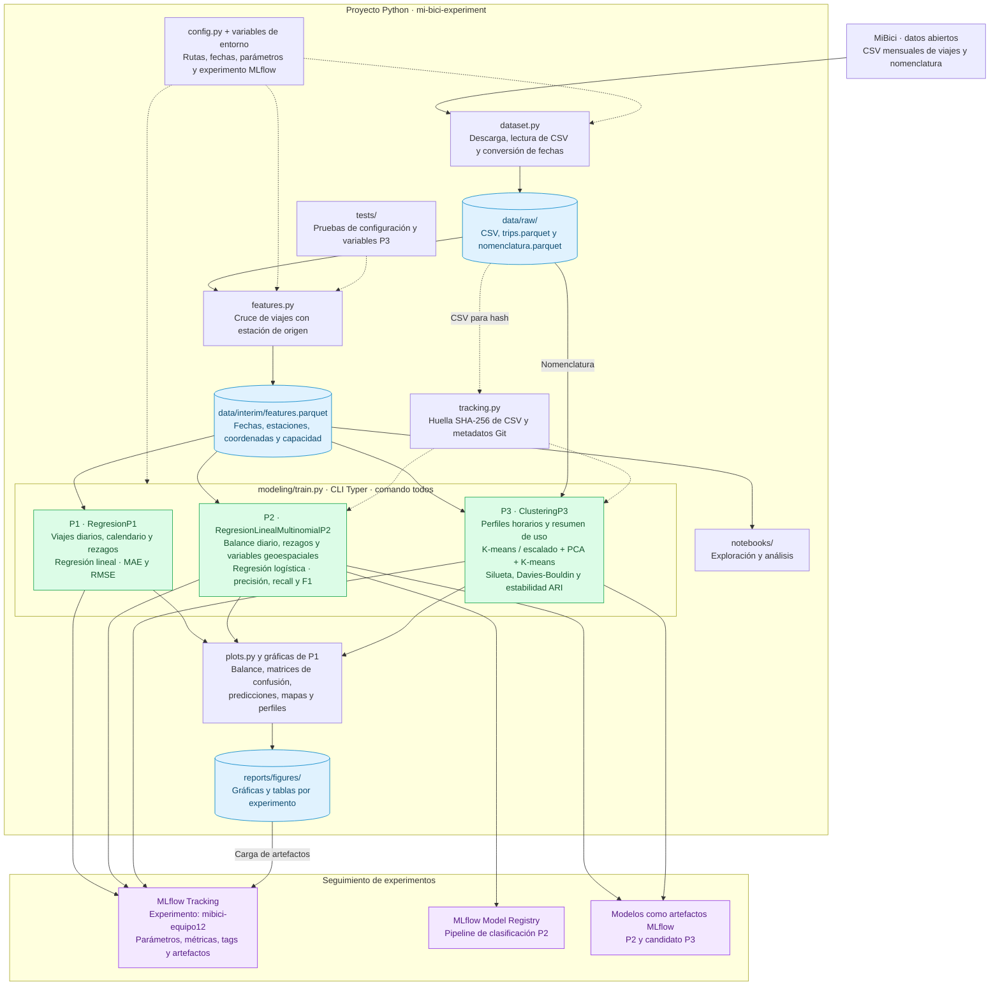

# Arquitectura de TC5061-Proyecto-Equipo12


Flujo implementado para ingesta, preparación de datos, entrenamiento y seguimiento de los tres problemas de MiBici. Las flechas continuas indican flujo de datos o resultados; las discontinuas, configuración y soporte.



## Ejecución

Desde `mi-bici-experiment/`:

```bash
python -m mi_bici_experiment.dataset
python -m mi_bici_experiment.features
python -m mi_bici_experiment.modeling.train todos
```

`todos` ejecuta P1, P2 y P3 en secuencia. Las variables específicas de cada problema se construyen en memoria mediante funciones de `features.py` durante el entrenamiento.

## Alcance actual

- MLflow usa la configuración del entorno; el diagrama no presupone un servidor ni un proveedor de almacenamiento. Los modelos P2 y P3 candidato se guardan como artefactos; P2 además se registra en el Model Registry. P1 registra métricas y gráficas.
- P2 y P3 usan `version_datos()`; P3 incorpora además los metadatos de `git_info()`. Los CSV y los almacenes locales de MLflow se excluyen de Git.
- `.github/workflows/mlflow.yml` contiene un flujo de GitHub Actions todavía incompleto: no automatiza el entrenamiento de extremo a extremo.
- `modeling/predict.py` es una plantilla. No hay un servicio de inferencia ni un despliegue implementado en el repositorio.
